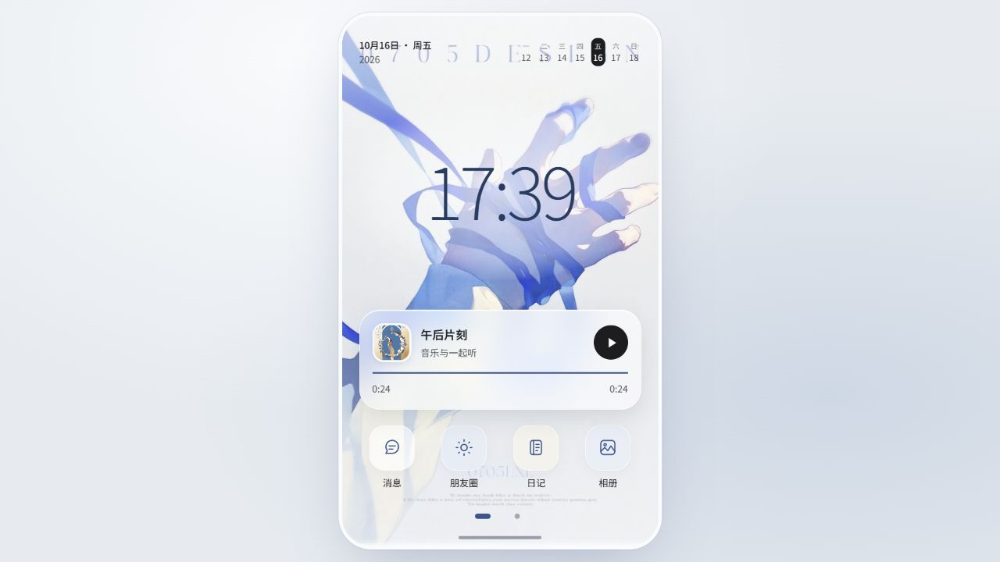

# 轻玻璃小手机 · 功能版 02

更新日期：2026-10-19。八个应用、一个音乐组件与两页桌面已经接入实际功能；首页每页一屏，支持横向滑动、鼠标拖动、页码按钮和键盘左右键。一部自己的手机容纳多位联系人，世界与主题可直接从桌面打开。

## Android 安装包

[下载轻玻璃小手机 0.2.1 APK](https://github.com/ruoege49-ship-it/lumi-phone/releases/download/v0.2.1/lumi-phone-0.2.1.apk) · [版本说明](https://github.com/ruoege49-ship-it/lumi-phone/releases/tag/v0.2.1)

当前安装包仍为 v0.2.1。2026-10-19 的联系人、图库头像、世界与主题入口、返回操作和旧记录迁移更新已包含在仓库源码中，需重新打包后才会进入 APK。

支持 Android 8.0 及以上，需要保持 Android System WebView 更新。安装后可直接打开，不需要电脑启动服务。进入「设置 → API 与模型」填写自己的服务地址、模型和密钥；语音识别和朗读分别设置。

安卓版保留原有桌面、头像、壁纸和全部应用，支持系统文件选择、保存备份、麦克风按需授权和系统返回键。角色、消息和附件保存在应用本地；浏览器里的数据可先导出完整备份，再在安卓应用中导入。备份排除密钥，迁移后重新填写。

这是独立的新应用，包名为 `com.ruoege.lumiphone`。构建、签名和验证说明见 [Android 说明](android/README.md)。

## 运行

安装 Node.js 22 或更新版本，下载或克隆仓库，在项目目录执行：

```sh
npm start
```

然后打开 [http://127.0.0.1:43151/](http://127.0.0.1:43151/)。Windows 也可以双击 `打开样品.cmd`。项目无需安装第三方依赖，服务默认只监听本机地址。

页面和 API 转发由同一个 Node 服务提供，运行时需要保留 `serve.mjs`、`gateway.mjs` 和 `dist/`。浏览器内的角色、聊天和附件保存在本机，跨浏览器或电脑使用时可通过应用里的完整备份迁移。



## 已接入的功能

| 入口 | 可用内容 |
| --- | --- |
| 消息 | 私聊、建群、指定多人分别回复；消息引用、搜索、收藏、图片与表情、录音附件、识别成文字、朗读角色回复、停止和重试；按角色开启主动来信 |
| 朋友圈 | 文字和图片动态、选择可见角色、角色发动态、点赞、多人评论、回复指定评论、搜索和收藏 |
| 日记 | 手写日记、角色按日期和已知经历生成草稿、编辑保存、查看原始来源、搜索收藏；日历里的约定、纪念日、改期、完成和取消 |
| 相册 | 导入图片、分类、查看原图、设置头像或壁纸、图片表情；图片统一保存并被其他应用引用 |
| 联系人 | 添加、JSON 导入、编辑、移除与恢复；从设备图库选择头像；私聊、群聊和主动来信；共同回忆的整理、手写、编辑、固定和停用 |
| 世界 | 新建、编辑和切换共同世界背景；控制是否在互动中使用背景 |
| 主题 | 手机壁纸、聊天背景、明暗主题、字号与桌面音乐组件；预览和保存 |
| 设置 | 文本 API 导入、连接测试、获取模型、生成参数；识别和朗读分别配置；备份、恢复、恢复点和回收站；生成记录 |
| 唯一音乐组件 | 本地音乐导入、歌单、播放控制、选角色一起听、轮流选歌、分享歌曲到聊天草稿、保存实际听歌时长 |

一部自己的手机容纳多位联系人。聊天、动态、日记、音乐与外观共用，添加或编辑联系人不切换手机。世界背景在桌面的「世界」App 填写、切换和开关；联系人默认跟随共同背景，也可在「更多设置」里关闭或指定单独背景。群聊和评论分别保存发言者，生成结果始终回到原会话。

本地记录格式为 v3。读取旧版 v2 时先创建恢复点，再整理各角色手机里的记录；原聊天、草稿、署名、收藏、附件和来源关联保留，旧世界的资料仍按参与者与背景过滤。重复私聊标注「旧会话」，同名未完成表单在「设置 → 备份与恢复 → 查看保留的旧草稿」继续编辑。

主动来信默认关闭。开启后受每日上限、间隔和安静时段限制，只在应用运行时检查。未来约定不会因为到期就自动成为已经发生的经历。修改或删除来源后，派生记忆停止自动参与生成，日记保留正文并显示来源状态。

## 连接模型服务

进入「设置 → API 与模型」，填写兼容 Chat Completions 的服务地址、密钥和模型，保存后测试连接。远程地址使用 HTTPS，本机服务可使用 HTTP。导入 JSON 支持 `baseUrl` / `base_url` / `apiUrl` / `endpoint`、`model` / `model_name`、`apiKey` / `api_key` / `key`。

聊天、群聊、朋友圈、日记、共同回忆、主动来信和角色选歌读取同一文本连接。语音识别与角色朗读分别配置兼容的 transcription / speech 服务。发送录音前可检查识别文字；生成语音失败时保留原文字，之后可以单独重试。

接口已通过本地测试服务联调。首次使用时在应用内配置自己的服务，密钥单独保存于浏览器，不随源码或数据备份上传。

## 数据与恢复

- 功能版使用 IndexedDB `lumi.functional.phone.v2`，记录、附件和密钥分别保存。
- 首次打开会读取旧存储 `lumi.lightglass.sample.v1`，迁移聊天、草稿、角色资料、外观、音乐进度与纸条；原存储保留。旧演示消息保留标识，并从新模型请求的历史中排除。
- 当前浏览器与地址决定存储空间；换浏览器或端口前先导出备份。
- 完整 JSON 备份包含记录、图片、音频和服务配置，排除密钥。导入先预览，应用前生成恢复点，记录和附件一起恢复。
- 密钥绑定服务地址，变更地址时需要重新填写。恢复备份会清除已保存密钥，之后重新填写自己的连接密钥。
- 删除角色可在回收站恢复；旧发言保留原作者。无须把记录复制给其他角色。

## 文件结构

- `dist/index.html`、`styles.css`、`features.css`：桌面与界面。
- `dist/main.mjs`、`views.mjs`：操作流程和功能面板。
- `dist/navigation.mjs`：页面层级、返回和表单现场。
- `dist/model.mjs`：数据、作用范围、来源和生成输入规则。
- `dist/personal-phone.mjs`：个人手机与旧角色记录迁移。
- `dist/storage.mjs`：本地保存、附件、备份和恢复。
- `dist/engine.mjs`、`api.mjs`、`request.mjs`、`gateway.mjs`：任务、共用请求规则和本地网关；`dist/platform.mjs` 接入安卓网络和文件保存。
- `dist/state.mjs`：旧样品兼容与迁移辅助；`dist/app.js` 保留为旧版文件，当前入口不再加载它。
- `state.test.mjs`、`features.test.mjs`、`platform.test.mjs`、`navigation.test.mjs`、`personal-phone.test.mjs`：自动检查；`test-provider.mjs`：本地联调用服务。
- `android/`：安卓宿主和设备检查；`scripts/build-android.ps1`：构建、签名和生成校验文件。
- `package.json`：启动与检查入口，无第三方依赖。

## 验证记录 · 2026-10-19

自动检查：`npm test`，41 项全部通过。新增覆盖逐层返回、表单与搜索保留、空联系人启动、个人资料重开恢复、共同与独立背景对实际生成请求的影响，以及旧记录迁移中的编号冲突、回复关联、收藏和草稿保留。

独立浏览器测试页已走通图库头像选择、预览、保存与刷新恢复，多联系人会话、本地测试接口回复、世界背景编辑与开关、音乐播放时编辑联系人，以及世界与主题 App 的打开和返回。360×640、200% 字号下两页桌面均一屏容纳；页面无控制台警告或错误。

### 历史验证 · v0.2.1

自动检查：`npm test`，26 项通过。覆盖迁移、手机与世界隔离、角色知情范围、任务归属、多人回复及重试去重、来源失效、日记日期、提醒、来信规则、备份关联及密钥排除、实际 API 参数和网关来源限制。

浏览器使用独立端口 43153 与本地测试服务 43152，避免测试数据进入用户的 43151 地址。已实际走通：新增角色、两人群聊回复、保存回忆和约定、角色日记及原文来源、图片动态和两人评论、指定评论回复及刷新恢复、上传音频并识别到草稿、生成可播放语音、导出与恢复完整备份、一起听歌实际播放、世界切换隔离、角色删除与恢复（v0.2.1 历史验证）。

320×568、360×640、390×844、430×932 的标准和 200% 字号，以及 1280×720 标准字号下，桌面两页均没有横向或纵向溢出。长内容面板保持滚动，滚动条外观隐藏。真实麦克风录制由用户使用时授权；本轮音频流程通过已有录音附件验证。

仓库展示图为 v0.2.1 的 `功能版02-桌面.jpg`。本机存档、测试导出的备份和旧版本快照已通过 `.gitignore` 排除。

## 原素材

用户提供的 `wallpaper-ribbon.png`、`portrait-birds.png`、`portrait-flowers.png` 均保留原文件，分别用于壁纸、头像与封面。字体保留 Noto Sans SC、Ma Shan Zheng、Noto Serif SC，许可见 `dist/assets/*-LICENSE.txt`。原 24 秒试听音频 `afternoon.wav` 保留。
